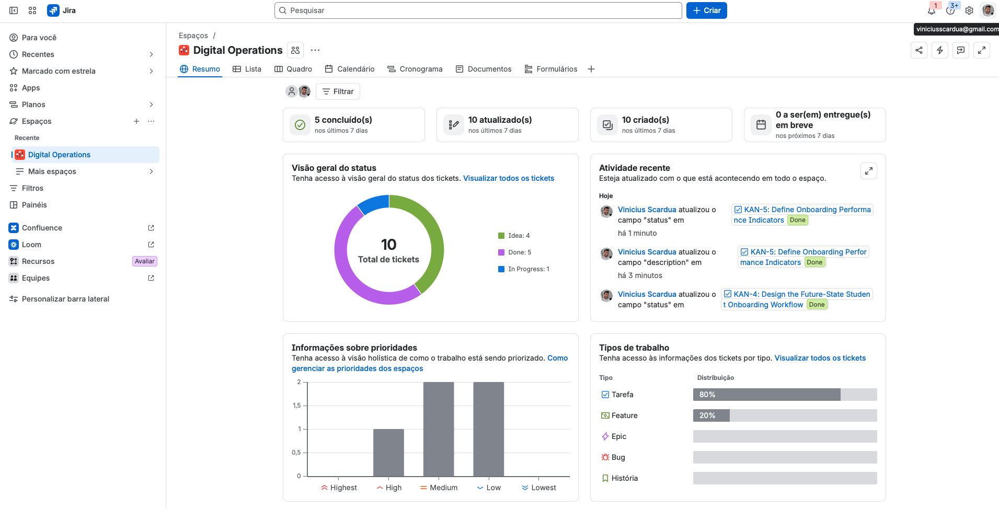
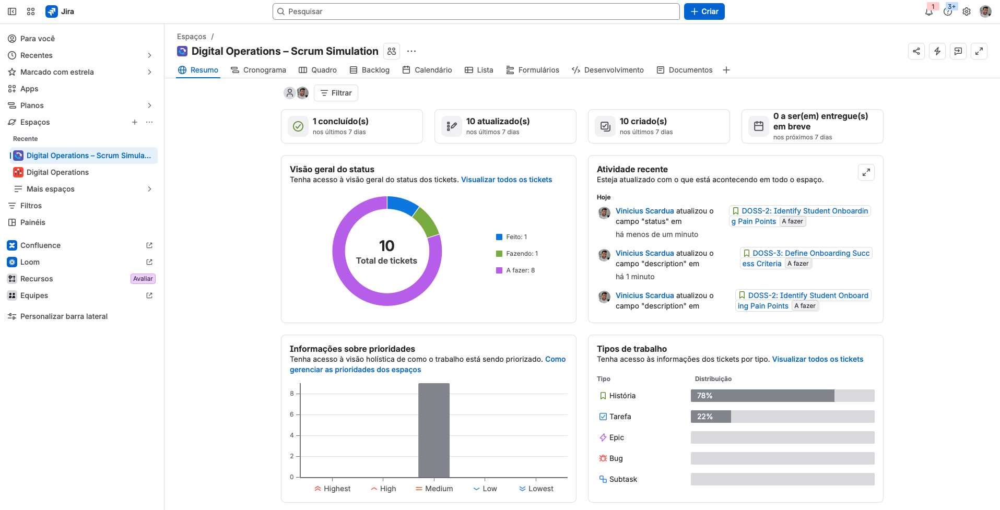
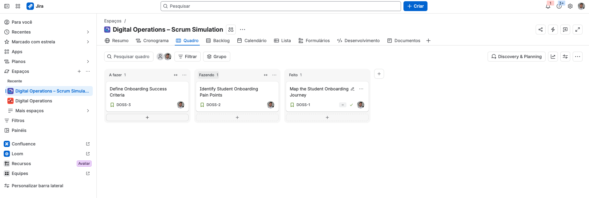

# Digital Operations & Agile Management

**By Vinicius Scardua**

A practical portfolio project demonstrating Digital Operations, process management, workflow organization, operational documentation, and Agile methodologies using Jira and Confluence.

The project combines two independent fictional workstreams to demonstrate the practical application of Kanban and Scrum.

## 1. Project Overview

This independent portfolio project explores how digital operations and process improvement initiatives can be structured, documented, prioritized, and tracked using Agile tools and practices.

It is divided into two fictional workstreams:

| Workstream | Methodology | Focus |
|---|---|---|
| Digital Operations | Kanban | Workflow management, task organization, prioritization, and continuous improvement |
| Student Onboarding Improvement | Scrum | Process discovery, backlog organization, sprint planning, and execution tracking |

## 2. Project Environments

The practical work was organized in Jira, with supporting documentation developed in Confluence.

- **[Jira — Digital Operations (Kanban)](https://viniciussworkspace-38722295.atlassian.net/jira/software/projects/KAN/list?jql=project%20%3D%20KAN%20ORDER%20BY%20cf%5B10019%5D%20ASC)** — Kanban board for operational workflow and task management.
- **[Jira — Digital Operations (Scrum Simulation)](https://viniciussworkspace-38722295.atlassian.net/jira/software/projects/DOSS/boards/2/backlog)** — Scrum backlog and Sprint 1 planning and execution.
- **[Confluence — Digital Operations](https://viniciussworkspace-38722295.atlassian.net/wiki)** — Documentation hub for processes, SOPs, workflow guidelines, performance indicators, and Scrum practices.

## 3. Tools & Methodologies

**Tools**
- Jira
- Confluence
- GitHub
- Markdown

**Methodologies and practices**
- Kanban
- Scrum
- Process Mapping
- Workflow Management
- Backlog Management
- Sprint Planning
- Continuous Improvement
- Standard Operating Procedures (SOP)

## 4. Workstream 1 — Digital Operations (Kanban)

The first workstream focuses on organizing a fictional student onboarding improvement initiative through a Kanban workflow.

**Objectives**
- Organize operational activities and priorities.
- Visualize work progress.
- Define workflow stages and management guidelines.
- Improve task visibility and work organization.
- Document processes and operational procedures.

**Jira implementation**

A Kanban board was configured with five workflow stages:

`Idea → To Do → In Progress → Testing → Done`

Work items were created, categorized, prioritized, and tracked across the workflow.

A manual Work in Progress (WIP) guideline of a maximum of two items in progress was defined. This was documented as a management rule and was not technically enforced by Jira.

**Confluence documentation**
- Kanban Workflow & WIP Policy
- Process Mapping & Improvement Opportunities
- Student Onboarding — Standard Operating Procedure (SOP)
- Onboarding Performance Indicators & Measurement Framework

## 5. Workstream 2 — Student Onboarding Improvement (Scrum)

The second workstream applies Scrum fundamentals to a fictional student onboarding improvement initiative.

**Objectives**
- Understand the current onboarding process.
- Identify potential process bottlenecks.
- Define improvement opportunities.
- Organize requirements into a Product Backlog.
- Plan and track a simulated sprint.

### Product Backlog

The Product Backlog contains ten work items:

| ID | Item | Type | Priority |
|---|---|---|---|
| US01 | Map the Student Onboarding Journey | Story | High |
| US02 | Identify Student Onboarding Pain Points | Story | High |
| US03 | Define Onboarding Success Criteria | Story | High |
| US04 | Design the Onboarding Workflow | Story | High |
| US05 | Create a Student Onboarding Checklist | Story | High |
| US06 | Define Welcome Communication Touchpoints | Story | Medium |
| US07 | Create Onboarding Communication Templates | Task | Medium |
| US08 | Define Onboarding Performance Indicators | Story | Medium |
| US09 | Document the Onboarding SOP | Task | Medium |
| US10 | Validate the Onboarding Process Through a Pilot Simulation | Story | Medium |

### Sprint 1 — Discovery & Planning

A one-week simulated sprint was created with the goal of understanding the current onboarding process, identifying pain points, and defining success criteria.

Three backlog items were selected:

- US01 — Map the Student Onboarding Journey
- US02 — Identify Student Onboarding Pain Points
- US03 — Define Onboarding Success Criteria

**Execution snapshot**
- US01 — Done
- US02 — In Progress
- US03 — To Do

The Sprint Review and Sprint Retrospective were documented as planned activities but were not conducted.

## 6. Evidence & Deliverables

Screenshots from Jira and Confluence demonstrate the practical configuration and use of the tools.

### Jira — Kanban



*Kanban board showing the operational workflow and work item progress.*

### Jira — Scrum



*Sprint 1 execution snapshot showing the status of selected work items.*



*Scrum board configured for the Student Onboarding Improvement simulation.*

### Confluence — Scrum Documentation


*Documentation of the Scrum framework and Sprint 1.*

## 7. Project Documentation

Five supporting documents are available in the repository:

| Document | Description |
|---|---|
| [Project Overview](docs/project-overview.md) | Project context, objectives, scope, and workstreams |
| [Process Mapping](docs/process-mapping.md) | Current-state analysis, potential pain points, and proposed improvements |
| [Onboarding SOP](docs/onboarding-sop.md) | Proposed standard operating procedure for student onboarding |
| [Kanban Workflow](docs/kanban-workflow.md) | Workflow stages, WIP policy, and management guidelines |
| [Scrum Framework](docs/scrum-framework.md) | Product Backlog, Sprint 1, user stories, and execution documentation |

## 8. Skills Demonstrated

- Digital Operations Management
- Process Mapping and Improvement
- Operational Documentation
- Standard Operating Procedures (SOP)
- Jira Project Management
- Confluence Documentation
- Kanban Workflow Management
- Scrum Fundamentals
- Product Backlog Organization
- User Story Definition
- Acceptance Criteria
- Sprint Planning and Tracking
- Performance Indicator Definition
- Work Organization and Prioritization

## 9. Repository Structure

```text
digital-operations-agile-management/
│
├── README.md
│
├── docs/
│   ├── project-overview.md
│   ├── process-mapping.md
│   ├── onboarding-sop.md
│   ├── kanban-workflow.md
│   └── scrum-framework.md
│
└── evidence/
    ├── jira/
    │   └── jira-project-progress-midpoint.png
    │
    ├── scrum/
    │   ├── jira-scrum-sprint-01-board.png
    │   └── jira-scrum-sprint-01-execution.png
    │
    └── confluence/
        └── confluence-scrum-framework-sprint-01.png
```

## 10. Disclaimer

This is an independent portfolio simulation created for learning and professional development.

All organizations, scenarios, processes, work items, and data are fictional.

The project does not represent a professional implementation for an actual company or client. It does not claim verified business results or real stakeholder feedback.

Its purpose is to demonstrate practical familiarity with Jira, Confluence, Kanban, Scrum, process documentation, and Digital Operations Management.
