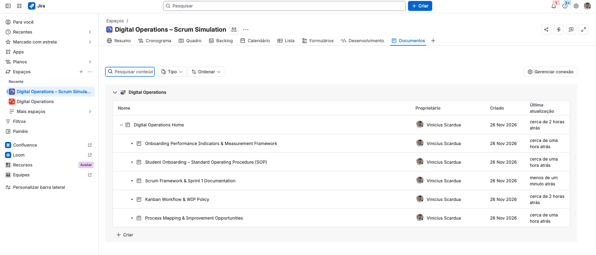

# Digital Operations & Agile Management

**By Vinicius Scardua**

A practical portfolio project demonstrating digital operations management, process improvement, project organization, and Agile methodologies using Jira and Confluence.


---

## 1. Project Overview

This repository documents an independent portfolio project developed to practice and demonstrate knowledge of digital operations, process management, project organization, and Agile methodologies.

The project combines two fictional business scenarios to explore different approaches to organizing work, improving processes, and managing deliverables.

The practical activities were carried out using **Jira** and **Confluence**, covering Kanban and Scrum workflows, backlog organization, task management, process mapping, operational documentation, and performance indicator definition.

### Project Objectives

- Demonstrate practical knowledge of Jira and Confluence.
- Apply Kanban and Scrum concepts in separate project environments.
- Organize and prioritize work items.
- Practice backlog management and Sprint Planning.
- Structure workflows and visualize work progress.
- Document operational processes and standard procedures.
- Define performance indicators and success criteria.
- Build a portfolio with tangible evidence of tool usage and methodology application.

## 2. Project Scope

The portfolio is organized into two complementary workstreams.

| Workstream | Focus | Methodology |
|---|---|---|
| Digital Operations | Student onboarding process improvement | Kanban |
| Student Onboarding Improvement | Discovery, planning, and process design | Scrum |

Both workstreams use fictional scenarios and simulated business contexts.

## 3. Tools & Methodologies

### Jira

Used for project organization, work item management, workflow visualization, backlog structuring, and Sprint tracking.

Practical activities included:

- Project and space configuration.
- Work item creation and categorization.
- Task prioritization.
- Kanban board organization.
- Product Backlog creation.
- User Stories and Tasks.
- Acceptance Criteria and Definition of Done.
- Sprint creation and planning.
- Sprint board tracking.

### Confluence

Used as the documentation environment for process definitions, operational guidelines, project information, and methodology documentation.

Documentation produced includes:

- Project overview.
- Kanban Workflow & WIP Policy.
- Process Mapping & Improvement Opportunities.
- Student Onboarding Standard Operating Procedure (SOP).
- Onboarding Performance Indicators & Measurement Framework.
- Scrum Framework & Sprint 1 Documentation.

### Methodologies

**Kanban**
- Workflow visualization.
- Work item organization.
- Work-in-progress (WIP) policy.
- Status tracking.
- Continuous flow concepts.

**Scrum**
- Product Backlog organization.
- User Story and Task definition.
- Backlog prioritization.
- Sprint Planning.
- Sprint Goal definition.
- Sprint execution tracking.
- Sprint Review and Retrospective planning.

## 4. Workstream 1 — Digital Operations (Kanban)

### Business Scenario

A fictional educational business requires a more structured student onboarding process.

The workstream focuses on understanding the existing process, identifying improvement opportunities, defining a future-state workflow, and documenting operational procedures.

### Activities

- Current-state process mapping.
- Identification of onboarding bottlenecks.
- Future-state workflow design.
- Definition of onboarding success criteria.
- Performance indicator framework.
- SOP documentation.
- Welcome communication planning.
- Onboarding checklist definition.
- Pilot validation planning.

### Jira Configuration

The Kanban workflow uses the following stages:

`Idea → To Do → In Progress → Testing → Done`

A manual WIP policy was defined, with a suggested maximum of two work items in progress at a time.

The policy is monitored manually and is not an automated Jira constraint.

### Confluence Documentation

The workstream includes process mapping, operational documentation, workflow definitions, and performance indicator specifications.

The performance indicators are proposed measurement frameworks, not actual measured business results.

## 5. Workstream 2 — Student Onboarding Improvement (Scrum)

### Business Scenario

A fictional educational institution seeks to improve the onboarding experience for newly enrolled students.

The objective is to establish a structured process by identifying student needs, mapping onboarding activities, and defining measurable success criteria.

### Product Backlog

The initial Product Backlog contains 10 work items:

| ID | Backlog Item | Type | Priority |
|---|---|---|---|
| US01 | Map the Student Onboarding Journey | Story | High |
| US02 | Identify Student Onboarding Pain Points | Story | High |
| US03 | Define Onboarding Success Criteria | Story | High |
| US04 | Design the Onboarding Workflow | Story | High |
| US05 | Create a Student Onboarding Checklist | Story | High |
| US06 | Define Welcome Communication Touchpoints | Story | Medium |
| US07 | Create Onboarding Communication Templates | Task | Medium |
| US08 | Define Onboarding Performance Indicators | Story | Medium |
| US09 | Document the Onboarding SOP | Task | Medium |
| US10 | Validate the Onboarding Process Through a Pilot Simulation | Story | Medium |

### Sprint 1 — Discovery & Planning

**Sprint Goal:**

Understand the current student onboarding process, identify pain points, and define success criteria.

**Planned duration:** One week (simulated).

**Selected work items:**

- US01 — Map the Student Onboarding Journey.
- US02 — Identify Student Onboarding Pain Points.
- US03 — Define Onboarding Success Criteria.

### Sprint Execution Snapshot

The first Sprint was started in Jira, and its work items were tracked on the Sprint board.

The recorded snapshot shows:

| Work Item | Status |
|---|---|
| US01 — Map the Student Onboarding Journey | Done |
| US02 — Identify Student Onboarding Pain Points | In Progress |
| US03 — Define Onboarding Success Criteria | To Do |

The User Stories include descriptions, acceptance criteria, and Definition of Done.

**Important:** This is an intermediate simulated execution snapshot. The Sprint Review and Retrospective are documented as planned activities, not completed events. No actual stakeholder feedback or business outcomes are claimed.

## 6. Evidence & Deliverables

Screenshots and documentation are organized in the repository to demonstrate the practical work carried out in Jira and Confluence.

### Jira — Kanban


### Jira — Scrum Overview


### Jira — Sprint 1 Board


### Confluence — Scrum Documentation



## 7. Skills Demonstrated

- Digital Operations Management.
- Process Mapping and Improvement.
- Operational Documentation.
- Standard Operating Procedures (SOP).
- Jira Project Management.
- Confluence Documentation.
- Kanban Workflow Management.
- Scrum Fundamentals.
- Product Backlog Organization.
- User Story Definition.
- Acceptance Criteria.
- Sprint Planning and Tracking.
- Performance Indicator Definition.
- Work Organization and Prioritization.

## 8. Project Structure

```text
digital-operations-agile-management/
│
├── README.md
│
├── docs/
│   ├── project-overview.md
│   ├── process-mapping.md
│   ├── onboarding-sop.md
│   ├── kanban-workflow.md
│   └── scrum-framework.md
│
├── evidence/
│   ├── jira/
│   │   └── jira-kanban-overview.png
│   │
│   ├── scrum/
│   │   ├── jira-scrum-overview.png
│   │   └── jira-scrum-sprint-01-board.png
│   │
│   └── confluence/
│       └── confluence-scrum-framework-sprint-01.png
│
└── project-deliverables/
```

## 9. Disclaimer

This is an independent portfolio project developed for practical learning and skills demonstration.

All business scenarios, organizations, processes, and data presented in this repository are fictional or simulated.

The project does not represent professional experience, an implementation for an actual company or client, or verified business results.

The purpose is to demonstrate practical familiarity with Jira, Confluence, Kanban, Scrum, digital operations, and process management concepts.

---

**Vinicius Scardua**  
Digital Operations | Product Operations | Processes & Projects

